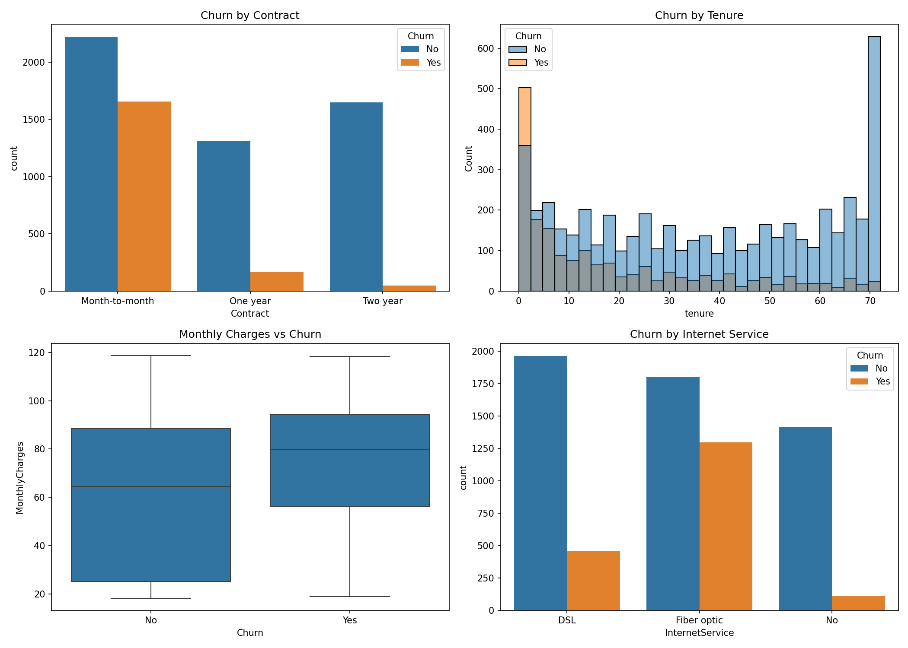
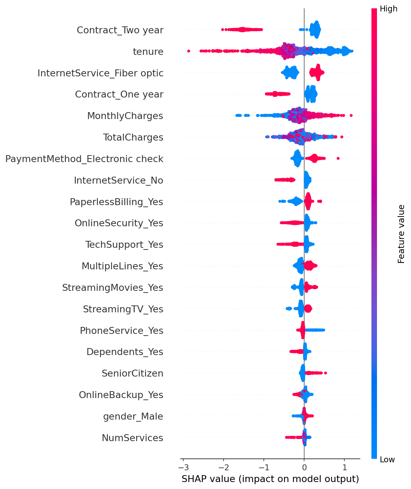

# 📉 Customer Churn Prediction & Analytics Dashboard

An end-to-end data analytics and machine learning project that predicts which telecom customers are likely to churn, explains **why** using SHAP, and presents the findings in an interactive dashboard for business teams.

🔗 **Live Dashboard:** https://customer-churn-prediction-gudifairsztwrm7ftjvgct.streamlit.app/
💻 **GitHub:** https://github.com/Rajeshwari-40/customer-churn-prediction

---

## 🎯 Business Problem

Acquiring a new customer costs far more than retaining an existing one. This project helps a telecom company:

- Identify customers who are likely to leave **before** they do
- Understand the key factors that drive churn
- Prioritise a high-risk customer list for the retention team
- Estimate the monthly revenue lost and at risk

---

## 📊 Key Results

| Metric | Value |
|---|---|
| Customers analysed | 7,043 |
| Overall churn rate | 26.5% |
| Monthly revenue lost to churn | $139,131 |
| Churn rate: month-to-month contracts | 42.7% |
| High-risk customers (probability > 70%) | 611 (about $50,091/month at risk) |
| Best model | XGBoost |
| ROC-AUC (XGBoost) | 0.XX |
| Accuracy / F1-score | 0.XX / 0.XX |

**Top churn drivers (from SHAP):** contract type, tenure, monthly charges, internet service type (fiber optic) and payment method (electronic check).

---

## 💡 Business Insights

- Customers on **month-to-month contracts** churn far more than those on one or two year contracts. Offering discounts for longer contracts can reduce churn.
- **New customers** (low tenure) are the most likely to leave, so the first 12 months are critical for retention.
- Customers paying **higher monthly charges** and using **fiber optic** internet show higher churn.
- **Electronic check** users churn more than customers on automatic payment methods.

---

## 🛠️ Tech Stack

| Area | Tools |
|---|---|
| Language | Python, SQL |
| Data analysis | Pandas, NumPy |
| Database | SQLite (SQL queries) |
| Visualisation | Matplotlib, Seaborn, Plotly |
| Machine learning | Scikit-learn, XGBoost |
| Explainability | SHAP |
| Dashboard | Streamlit |
| Tools | Google Colab, Git, GitHub |

---

## 🔄 Project Workflow

1. **Data collection:** Telco Customer Churn dataset (Kaggle), 7,043 customers and 21 columns
2. **SQL analysis:** churn rate, churn by contract and payment method, revenue lost
3. **Data cleaning:** fixed the `TotalCharges` data type, handled missing values, removed duplicates
4. **EDA:** explored churn against contract, tenure, monthly charges and internet service
5. **Feature engineering:** created `TenureGroup` and `NumServices`, encoded categorical variables
6. **Modelling:** trained and compared Logistic Regression, Random Forest and XGBoost
7. **Explainability:** used SHAP to understand which features drive each prediction
8. **Dashboard:** built an interactive Streamlit app with filters, KPIs and a high-risk customer list

---

## 🖥️ Dashboard Features

- **KPI cards:** total customers, churn rate, monthly revenue lost, high-risk customers
- **Sidebar filters:** contract, payment method, internet service, risk threshold
- **4 tabs:** Overview, Churn Drivers, High-Risk Customers, Model Insights
- **High-risk customer table** with a churn-risk progress bar
- **Download button** to export the high-risk customer list as CSV

---

## 🖼️ Screenshots

### Exploratory Data Analysis


### SHAP Feature Importance


---

## 📁 Repository Structure

```
customer-churn-prediction/
├── app.py                   # Streamlit dashboard
├── requirements.txt         # Python dependencies
├── telco_scored.csv         # Dataset with model churn probabilities
├── Churn_Prediction.ipynb   # Full analysis and model notebook
├── eda.png                  # EDA charts
├── shap_summary.png         # SHAP summary plot
├── .streamlit/config.toml   # Dashboard theme
└── README.md
```

---

## ▶️ How to Run Locally

```bash
# 1. Clone the repository
git clone https://github.com/Rajeshwari-40/customer-churn-prediction.git
cd customer-churn-prediction

# 2. Install dependencies
pip install -r requirements.txt

# 3. Start the dashboard
streamlit run app.py
```

To re-run the analysis and model training, open `Churn_Prediction.ipynb` in Google Colab or Jupyter Notebook.

---

## 🚀 Future Improvements

- Hyperparameter tuning with GridSearchCV
- Handling class imbalance with SMOTE
- Real-time prediction form for a single customer
- Connect the dashboard to a live database

---

## 👩‍💻 Author

**Rajeshwari M B**
B.E. Computer Science, APS College of Engineering, Bengaluru
GitHub: [Rajeshwari-40](https://github.com/Rajeshwari-40)

---

*Dataset: [Telco Customer Churn](https://www.kaggle.com/datasets/blastchar/telco-customer-churn) on Kaggle.*
